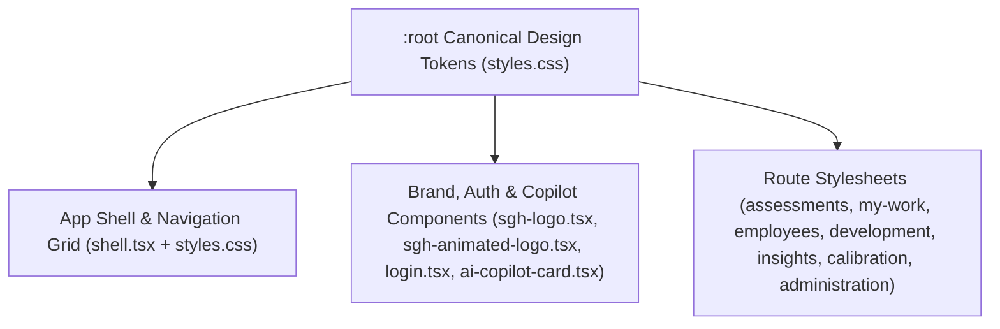

# Frontend UI, Layout Sizing, and Design System Unification

*   **Author:** mustafapato863-netizen
*   **Status:** Approved (EGM Goldfish Review Resolved)
*   **Date:** 2026-11-05

--------------------------------------------------------------------------------

## Overview

AssessFlow (`@assessflow/web`) is a React 19 and Vite single-page web application used by human resources (HR) partners, assessors, people managers, and system administrators to run employee assessment, promotion, calibration, and post-assessment development workflows. Each employee evaluation is tracked as an **Assessment Case** (also called a **Case Dossier**) that advances through seven sequential workflow stages: `Request`, `Eligibility`, `Plan`, `Assessment`, `Result`, `Decision`, and `Follow-up`. Completed assessments feed into a **9-Box Calibration Matrix** (a 3-by-3 grid plotting candidate performance against potential) and a **Development Plan** tracker.

Over multiple feature iterations, `@assessflow/web` accumulated divergent color, typography, and border-radius definitions across a 9,846-line global stylesheet ([apps/web/src/styles.css](../../apps/web/src/styles.css)) and seven route-scoped stylesheets ([assessments.css](../../apps/web/src/routes/assessments.css), [my-work.css](../../apps/web/src/routes/my-work.css), [employees.css](../../apps/web/src/routes/employees.css), [development.css](../../apps/web/src/routes/development.css), [insights.css](../../apps/web/src/routes/insights.css), [administration.css](../../apps/web/src/routes/administration.css), and [calibration.css](../../apps/web/src/routes/calibration-view/calibration.css)).

This specification defines a structural layout remediation and design token unification across `@assessflow/web`. It fixes application shell grid defects, replaces non-functional Tailwind CSS utility classes with scoped CSS rules, resolves grid overflow and compression on standard laptop (`1280px–1440px`) and tablet/mobile (`< 1100px`) viewports, restores typographic hierarchy, standardizes shared UI component dimensions, and removes `2,128 lines` of superseded CSS blocks without changing backend APIs or workflow state machines.

## The Problem

An audit of `apps/web/src` stylesheets and route components identified six structural failure categories that degrade visual consistency, readability, and layout sizing:

1.  **Application Shell & Navigation Geometry Defects**:
    *   On desktop viewports wider than `1100px`, collapsing the left navigation sidebar shrinks the sidebar element from `264px` to `82px`, but the parent application shell CSS Grid container retains a fixed `264px` first column track. This leaves a `182px` blank gap between the collapsed sidebar and the main content area.
    *   Two separate sidebar collapse buttons render simultaneously on desktop (one in the sidebar footer and one in the top navigation bar), and the sidebar footer button triggers collapse via a DOM query (`document.querySelector`) instead of a React state callback.
    *   On mobile viewports (`<= 680px`), opening the slide-over navigation drawer renders no backdrop overlay to dim the page or close the drawer on outside clicks, restores hidden child containers using `display: initial` (which evaluates to `display: inline` in CSS) rather than their required `grid`, `flex`, or `block` display modes, and unmounts navigation labels if the desktop `collapsed` state was active prior to resizing.
    *   Navigating between routes causes background color jumps because the global workspace background is `#f8fafc`, while the Overview and Calibration routes override the page container background to `#f6f7fb`.

2.  **Uninstalled Tailwind CSS Utility Classes**:
    *   `@assessflow/web` does not have Tailwind CSS installed in [apps/web/package.json](../../apps/web/package.json), yet the Saudi German Health (SGH) authentication screen ([login.tsx](../../apps/web/src/routes/login.tsx)) and brand logo components ([sgh-logo.tsx](../../apps/web/src/design-system/brand/sgh-logo.tsx), [sgh-animated-logo.tsx](../../apps/web/src/design-system/brand/sgh-animated-logo.tsx)) apply Tailwind utility class strings. Because these class names have no definitions in `styles.css`, the mobile login header, vertical divider, and logo ambient halo render without layout, color, or sizing styles.
    *   The AI Copilot panel ([ai-copilot-card.tsx](../../apps/web/src/features/case/ai-copilot-card.tsx)), which provides automated evidence and competency suggestions inside a case, applies `className="spinner"` to loading icons, whereas `styles.css` defines the rotation keyframe animation on `.spin`, leaving loading indicators static.

3.  **Desktop Grid Compression and Horizontal Overflow (`1280px–1440px`)**:
    *   On the Overview dashboard ([overview.tsx](../../apps/web/src/routes/overview.tsx)), the 8-stage workflow pipeline strip (`Request`, `Eligibility`, `Planning`, `Assessment`, `Result`, `Recommendation`, `Approval`, `Development`—which splits the Case Dossier's `Decision` stage into separate `Recommendation` and `Approval` cards) places all 8 cards into a single row down to `1200px`. On a `1280px` or `1366px` laptop screen with an expanded `264px` sidebar, each card receives approximately `98px` of width, causing single-line stage labels and bottleneck badges to clip.
    *   The Overview **Priority Action Queue** (a ranked list of cases at risk of breaching Service Level Agreement (SLA) deadlines) sits inside the left track of a two-column split layout, yet each row defines a 5-column grid whose fixed tracks and child button widths consume `664px`, squeezing the stage column and overflowing on viewports between `850px` and `1366px`.
    *   The Growth Follow-ups panel in the Overview work grid is pinned to column 2, row 2, leaving column 1 of row 2 blank whenever the left column contains a single panel.
    *   The Overview page header subtitle concatenates multiple operational counters into a single paragraph forced to single-line ellipsis truncation, cutting off the summary on standard monitors.
    *   On the Case Detail route ([case.tsx](../../apps/web/src/routes/case.tsx)), four full-width header and navigation bars stack vertically before the main case content: the case hero panel, an interactive 7-stage stepper, the executive action bar, and a secondary stage tab bar that repeats the same 7 stage buttons. Together with the topbar, this consumes over `420px` of vertical height before the dossier content begins.
    *   Inside the Case Detail **Result Summary** (the panel displaying weighted technical and behavioral competency scores), placing two `420px` minimum-width 5-column tables side-by-side inside a main column that shares space with a `264px` sidebar and a `270px` context rail compresses criterion titles to a few characters.

4.  **Responsive Table Breakdown Below `1100px`**:
    *   In the Assessments ([assessments.tsx](../../apps/web/src/routes/assessments.tsx)), Employees ([employees.tsx](../../apps/web/src/routes/employees.tsx)), and Calibration ([Calibration.tsx](../../apps/web/src/routes/calibration-view/Calibration.tsx)) routes, media queries at `max-width: 1100px` hide the table header row and stack middle cells vertically into column 2 while inheriting a `20px` desktop grid gap. This produces tall rows (`~180px`) of unlabeled dates, stages, and counters.

5.  **Typography & Visual Hierarchy Overrides**:
    *   A selector block in `styles.css` forces `font-size: 13px !important` and muted gray `#5b6078` across more than 40 elements inside the Overview route, including primary employee names, table headers, badges, and buttons. This removes visual contrast between primary identifiers and secondary metadata.
    *   Multiple rules in `styles.css` reference `font-family: var(--font)`, a CSS custom property that is not defined in `:root`, while the Scorecard and Result Summary panels hardcode `'IBM Plex Sans'` on 11 selectors inside a page otherwise set in `'Geist'`.
    *   Stylesheets declare non-standard font weights (`650`, `750`, `850`) not loaded in [apps/web/index.html](../../apps/web/index.html) and set badge text as small as `9px`–`10px`.

6.  **Component Token Fragmentation & Dead CSS Bloat**:
    *   Core UI primitives (page headers, Key Performance Indicator (KPI) summary cards, user avatars, and action buttons) use conflicting border radii (`8px` to `99px`), heights (`30px` to `48px`), and loading structures (for example, [my-work.tsx](../../apps/web/src/routes/my-work.tsx) renders an eyebrow label during loading and removes it once data loads, shifting the header vertically).
    *   `styles.css` retains `2,128 lines` of dead CSS across five blocks from superseded iterations—specifically two unused Login page implementations, an unused Calibration workspace implementation, and two unused v1 Scorecard blocks—that have zero references in any `.tsx` file.

## Goals

*   **Eliminate Layout Dead Zones and Overflows**: Remove the `182px` collapsed-sidebar gap on desktop, restore mobile sidebar child display modes and backdrop behavior, and prevent horizontal clipping in the Overview Pipeline, Priority Action Queue, and Case Result Summary across `375px`, `768px`, `1024px`, `1280px`, `1366px`, and `1920px` viewports.
*   **Remove Unstyled Utility Classes**: Replace all non-functional Tailwind CSS class names in `login.tsx`, `sgh-logo.tsx`, and `sgh-animated-logo.tsx` with defined CSS rules, and align the spinner class in `ai-copilot-card.tsx` with `.spin`.
*   **Unify the Design Token Contract**: Establish a single set of canonical CSS custom properties in `:root` consumed by `styles.css` and all seven route-scoped CSS files.
*   **Restore Typographic Hierarchy & Accessible Sizing**: Remove the blanket `13px !important` / `#5b6078` override on the Overview route, resolve undefined `var(--font)` references to `var(--font-sans)`, map non-standard font weights (`650`/`750`/`850`) to loaded weights (`600`/`700`/`800`), and set a minimum `11px` font size for badges and metadata labels.
*   **Consolidate Case Navigation & Label Responsive Tables**: Merge the duplicate stage tab bar and interactive stepper on the Case Detail route into a single stage navigation bar (preserving the `"Complete Dossier (All Stages)"` toggle and all Playwright test selectors), and add inline column labels with compact spacing to responsive tables below `1100px`.
*   **Remove Dead CSS Blocks**: Delete the five verified unused CSS blocks (`2,128 lines`) from `apps/web/src/styles.css` while passing all unit, build, formatting, and E2E checks.

## Non-Goals

*   Modifying backend NestJS controllers, services, or Prisma database schemas in `apps/api` or `packages/database`.
*   Changing shared domain contracts or Zod validation schemas in `packages/contracts`.
*   Installing Tailwind CSS, CSS-in-JS libraries, or third-party component kits.
*   Altering assessment workflow business rules, role-based access control permissions, or scorecard calculation formulas.

## Open Questions

*   None. All architectural, layout, and design token decisions are resolved in this specification.

## Critical User Journeys (CUJs)

### CUJ 1: Desktop Sidebar Collapse and Mobile Drawer Navigation

*   **Given**: An authenticated user is viewing any workspace route on a desktop viewport (`1440x900`) or a mobile viewport (`375x812`).
*   **When**: On desktop, the user clicks the sidebar collapse button; on mobile, the user taps the mobile menu button to open the drawer and taps the backdrop overlay to close it.
*   **Then**: On desktop, the application shell transitions its first column track from `264px` to `82px` with zero gap between the sidebar and main content, and only one collapse toggle button is rendered in the shell. On mobile, the sidebar slides over a dimmed backdrop overlay, all internal containers, navigation item labels, and count badges render with their designated `grid`, `flex`, or `block` layouts regardless of prior desktop collapse state, and tapping the backdrop closes the drawer.

### CUJ 2: Overview Dashboard Scanning on Standard Laptop Viewports

*   **Given**: An HR partner opens `/overview` on a `1280x800` or `1366x768` laptop screen with the sidebar expanded.
*   **When**: The Overview page renders the header subtitle, KPI metric cards, 8-stage pipeline strip, Priority Action Queue, and Growth Follow-ups panel.
*   **Then**:
    *   The page subtitle wraps across multiple lines without single-line ellipsis truncation.
    *   The 8-stage pipeline renders as a 2-row by 4-column grid below `1600px` with vertical spacing that prevents bottleneck badges from overlapping adjacent rows.
    *   The Priority Action Queue rows fit within the Overview work grid without horizontal overflow, and the Growth Follow-ups panel flows in the grid without leaving an empty column cell.
    *   Primary employee names in the Recent Assessment Cases table render in primary dark ink (`#0f172a`, `font-weight: 600`) rather than muted `#5b6078`.

### CUJ 3: Case Dossier Stage Navigation and Result Summary Inspection

*   **Given**: An assessor or HR partner opens a case dossier (`/#/cases/:id`).
*   **When**: The user switches between workflow stages (`Request`, `Eligibility`, `Plan`, `Assessment`, `Result`, `Decision`, `Follow-up`, or `Complete Dossier (All Stages)`) and views the Result Summary tables.
*   **Then**:
    *   Stage navigation is controlled through a single unified stepper and filter bar with valid `aria-pressed` toggle semantics and without rendering a second redundant 7-button tab bar underneath the executive action bar.
    *   The Result Summary competency tables stack in a single full-width column inside the case main area on viewports below `1680px`, giving criterion titles at least `180px` of width.

### CUJ 4: Brand & Authentication Rendering Across Desktop and Mobile Viewports

*   **Given**: An unauthenticated user opens `/#/login` on desktop (`1280x800`) or mobile (`375x812`), or an assessor triggers an AI Copilot action inside a case.
*   **When**: The login screen, SGH brand logos, and AI Copilot loading state render.
*   **Then**: All layout, spacing, typography, divider, and ambient halo styles render via defined semantic CSS classes in `styles.css` with zero reliance on Tailwind utility classes, and the AI Copilot loading icon rotates using the `.spin` animation class.

### CUJ 5: Cross-Route Visual Consistency and Tablet Table Inspection

*   **Given**: A user navigates across `/overview`, `/my-work`, `/assessments`, `/employees`, `/calibration`, `/development`, `/insights`, and `/admin` on desktop and tablet (`900px` width).
*   **When**: The routes transition between loading and loaded states, and tables adapt to the `900px` viewport.
*   **Then**:
    *   The page canvas background remains uniform across all routes without color shifts.
    *   Page headers maintain the same vertical position between loading and loaded states.
    *   Avatars use a circular shape, primary action buttons share a uniform control height, and KPI cards share a uniform border radius.
    *   Below `1100px`, collapsed table rows in Assessments, Employees, and Calibration display inline field labels with compact vertical spacing instead of unlabeled tall stacks.

## Technical Plan (Architecture)

The remediation organizes the frontend styling architecture into a two-tier CSS system: a canonical token and shell layer in [apps/web/src/styles.css](../../apps/web/src/styles.css), and route-scoped layout modules that alias their local custom properties to the canonical `:root` tokens.



### 1. Canonical Design Token Layer

Six route stylesheets (`assessments.css`, `my-work.css`, `employees.css`, `calibration.css`, `development.css`, and `insights.css`) currently redeclare `--accent`, `--ink`, `--muted`, and `--line` (plus `--ground` in `my-work.css`), while `administration.css` declares `--admin-indigo`, `--admin-bg`, `--admin-border`, and `--admin-muted`, all with values that diverge from `:root` in `styles.css`. We establish `:root` in `styles.css` as the single source of truth using its existing custom properties—`--canvas` (`#f8fafc`), `--surface` (`#ffffff`), `--text` (`#0f172a`), `--secondary` (`#475569`), `--muted` (`#64748b`), `--border` (`#e2e8f0`), `--indigo` (`#4f46e5`), `--brand-soft` (`#eef2ff`), `--font-sans`, and `--font-heading`—augmented with six new tokens: `--font` (aliased to `var(--font-sans)`), `--font-mono` (starting with the loaded `'IBM Plex Mono'` webfont), `--radius-card` (`14px`), `--radius-control` (`10px`), `--radius-avatar` (`999px`), and `--control-height` (`40px`). Each route stylesheet aliases only the custom properties it actually consumes to these `:root` tokens.

### 2. Application Shell & Responsive Drawer Synchronization

The application shell grid in `styles.css` is updated to bind its first column width to the collapsed state of the sidebar across all desktop breakpoints using `:has(.sidebar.collapsed)`. The duplicate collapse button in the sidebar footer is removed from [apps/web/src/components/shell.tsx](../../apps/web/src/components/shell.tsx) so the topbar toggle button is the single collapse trigger. On mobile viewports (`<= 680px`), `shell.tsx` mounts a backdrop overlay when the mobile drawer is open and passes `collapsed={collapsed && !mobileMenuOpen}` so mobile navigation labels are always mounted in the DOM, while `styles.css` restores all hidden sidebar child selectors using explicit `grid`, `flex`, and `block` display values instead of `display: initial`.

### 3. Semantic Replacement of Orphaned Utility Classes

In `login.tsx`, the mobile brand header reuses the existing `.sgh-brand-divider`, `.sgh-brand-title`, and `.sgh-brand-subtitle` rules already defined in `styles.css` for the desktop header. Remaining Tailwind utility classes in `sgh-logo.tsx` and `sgh-animated-logo.tsx` are replaced with semantic classes matching their actual component props (`variant` and `size`). In `ai-copilot-card.tsx`, loading icons switch from `.spinner` to the existing `.spin` keyframe class.

### 4. Overview & Case Detail Responsive Reflow

*   **Overview Route**: The 8-stage pipeline grid defaults to a 4-column, 2-row grid with vertical row spacing that accommodates top-mounted bottleneck badges, and expands to 8 columns only on wide desktop viewports (`>= 1600px`). The local `.overview-page` variable overrides and blanket `13px !important` / `#5b6078` typography rules are removed. The Overview work grid collapses to a single column below `1400px`, the Priority Action Queue row template relaxes fixed chip and button widths, and the Growth Follow-ups panel removes its hardcoded row/column coordinates so grid items auto-place without empty cells.
*   **Case Detail Route**: The `"Complete Dossier (All Stages)"` filter button is integrated into a header row inside the interactive stepper panel using `aria-pressed` toggle semantics, horizontal touch scrolling on mobile (`<= 680px`) is scoped to `.stepper-track`, and the duplicate 7-stage tab bar below the executive action bar is removed. Result Summary tables default to a single full-width column and split into two columns only on viewports `>= 1680px`.

### 5. Responsive Table Labels & Dead CSS Removal

*   **Responsive Table Data Labels**: Middle table cells in Assessments, Employees, and Calibration receive `data-label` attributes. Below `1100px`, CSS `::before` pseudo-elements render the `data-label` prefix inline with compact row spacing.
*   **Dead CSS Removal**: Five superseded CSS blocks in `styles.css` (`2,128 lines` total across `.login-page-container`, `.login-page-root`, `.calibration-workspace`, and two legacy `.assessment-scorecard` / `.scorecard-*` v1 blocks) that have zero references in `.tsx` files are deleted.

## Alternatives Considered

### Alternative A: Install Tailwind CSS v4 to Support Existing Utility Classes in Brand and Login Components

*   **Pros**: Makes the existing utility classes in `login.tsx`, `sgh-logo.tsx`, and `sgh-animated-logo.tsx` apply styles without editing their `className` props.
*   **Cons**: Adds a build-time PostCSS/Vite dependency, introduces a fifth styling system alongside `styles.css` and route-scoped CSS files, and risks global CSS reset (Preflight) collisions with existing custom button, table, and input rules.
*   **Reason for Rejection**: Rejected by author: `@assessflow/web` uses semantic CSS across all routes and components except `login.tsx`, `sgh-logo.tsx`, and `sgh-animated-logo.tsx`; replacing orphaned utility class strings in those three files with scoped CSS rules avoids adding build dependencies and prevents Preflight stylesheet collisions.

### Alternative B: Migrate All Global and Route Stylesheets to CSS Modules or CSS-in-JS

*   **Pros**: Enforces build-time class scoping and prevents selector collisions between routes.
*   **Cons**: Requires renaming imports and rewriting `className` bindings across every route and component file, which breaks Playwright E2E tests (`apps/web/e2e/*.spec.ts`) that query semantic class selectors such as `.case-layout`, `.decision-panel`, `.status-badge`, `.brand-copy`, and `.activity-panel`.
*   **Reason for Rejection**: Rejected by author: Retaining semantic class names and route-prefixed CSS files (`as-`, `mw-`, `em-`, `dv-`, `in-`, `cb-`) while unifying their `:root` CSS custom properties fixes visual inconsistencies without breaking E2E selector contracts.

### Alternative C: Force Horizontal Scrolling (`overflow-x: auto`) on All Route Tables Below `1100px`

*   **Pros**: Preserves the desktop multi-column table header without responsive cell reflow.
*   **Cons**: Requires horizontal two-axis scrolling on tablets (`768px–1024px`) and mobile viewports (`375px`), hiding the primary row action button off-screen to the right.
*   **Reason for Rejection**: Rejected by author: Keeping the responsive 3-track grid (`avatar | details | action button`) below `1100px` while adding `data-label` inline headers and compact row gaps keeps both the candidate identity and the primary action button visible without horizontal scrolling.

## Risks & Mitigations

*   **Playwright E2E and Accessibility Selector Regressions**: Consolidating the Case Detail stage navigation, updating mobile sidebar styles, or modifying the Employees page header could break existing Playwright E2E tests (`smoke.spec.ts`, `a11y.spec.ts`, `case-deepening.spec.ts`).
    *   *Mitigation*: Preserve `.stage-tab-button` on the `"Complete Dossier (All Stages)"` button, use `aria-pressed` instead of invalid `role="tablist"` ownership on the consolidated stepper header, restore all mobile sidebar navigation labels so `getByRole('button', { name: /Assessments/i })` succeeds at `375x812`, and restore `.page-heading`, `.eyebrow`, and `.pipeline-note` in `employees.tsx` to match [apps/web/e2e/case-deepening.spec.ts](../../apps/web/e2e/case-deepening.spec.ts).
*   **CSS `:has()` Selector Support**: Using `.app-shell:has(.sidebar.collapsed)` requires browser support for the CSS relational pseudo-class `:has()`.
    *   *Mitigation*: `:has()` is baseline-supported across all modern Chromium, Firefox, and Safari versions targeted by Vite 7 (`esnext` / modern evergreen browsers) and is already used in the existing stylesheets.
*   **Accidental Deletion of Active Keyframes During Dead CSS Pruning**: The `@keyframes spin` and `.spin` rules sit immediately after the legacy `.login-page-root` block in `styles.css`.
    *   *Mitigation*: Explicitly preserve the `@keyframes spin` and `.spin` block when deleting `.login-page-root`, and verify its presence via automated unit tests.

--------------------------------------------------------------------------------

## Non-Functional Requirements

*   **Accessibility (WCAG 2.2 AA)**:
    *   All interactive action controls must maintain a minimum touch target height of `38px` (`40px` standard via `--control-height`), satisfying [apps/web/e2e/a11y.spec.ts](../../apps/web/e2e/a11y.spec.ts) Scan 3.
    *   Zero critical or serious `axe-core` WCAG 2.2 AA violations on the Case Workspace and Approval Decision views (`apps/web/e2e/a11y.spec.ts` Scans 1 & 2).
    *   Minimum font size of `11px` for all badges, chips, and metadata labels; primary text (`#0f172a`) and secondary text (`#475569`) on `#ffffff` or `#f8fafc` surfaces maintain contrast ratios above `7:1`.
*   **Performance & Bundle Size**:
    *   Zero new runtime or build dependencies added to `package.json`.
    *   Removing dead CSS blocks from `apps/web/src/styles.css` reduces raw stylesheet size by `2,128 lines` (~42 KB uncompressed).
*   **Rollout & Rollback**:
    *   All changes are confined to `apps/web/src` static stylesheets and React components; rollback is a single git revert commit with no database migration or API compatibility impact.

--------------------------------------------------------------------------------

## Detailed Implementation Plan

The implementation is partitioned into five sequential phases. Every phase leaves `@assessflow/web` in a compiling, type-checked, and testable state:

*   **Phase 1 (Token Foundation & App Shell Geometry)**: `styles.css` sub-items 1.1, 1.2, 1.3, 1.7, 1.8 and `shell.tsx` (Item 2).
*   **Phase 2 (Brand, Auth & Copilot Class Remediation)**: `styles.css` sub-item 1.9, `sgh-logo.tsx` (Item 3), `sgh-animated-logo.tsx` (Item 4), `login.tsx` (Item 5), and `ai-copilot-card.tsx` (Item 6).
*   **Phase 3 (Overview & Case Detail Layout and Typography Reflow)**: `styles.css` sub-items 1.4, 1.5, 1.6, 1.10 and `case.tsx` (Item 7).
*   **Phase 4 (Route Token Unification, Responsive Table Labels & Dead CSS Removal)**: `my-work.tsx` (Item 8), `my-work.css` (Item 9), `assessments.tsx` (Item 10), `assessments.css` (Item 11), `employees.tsx` (Item 12), `employees.css` (Item 13), `Calibration.tsx` (Item 14), `calibration.css` (Item 15), `development.css` (Item 16), `insights.css` (Item 17), `administration.css` (Item 18), and `styles.css` sub-item 1.11.
*   **Phase 5 (Automated Layout & Style Invariant Tests)**: `ui-layout-invariants.test.ts` (Item 19).

### Target Files to Create/Modify

#### 1. [`apps/web/src/styles.css`](../../apps/web/src/styles.css) (Modify)

*   **Type / Scope**: Global Stylesheet (`CSS`, Phases 1–4)
*   **Proposed Changes**:
    1.  **[Phase 1] Canonical `:root` Tokens (`L1–45`)**: Retain the existing `:root` custom properties (`--canvas: #f8fafc`, `--surface: #ffffff`, `--surface-subtle: #f1f5f9`, `--text: #0f172a`, `--secondary: #475569`, `--muted: #64748b`, `--border: #e2e8f0`, `--border-strong: #cbd5e1`, `--indigo: #4f46e5`, `--indigo-deep: #4338ca`, `--brand-soft: #eef2ff`, `--font-sans`, `--font-heading`) and add six new tokens inside `:root` before `L45`:
        ```css
        --font: var(--font-sans);
        --font-mono: 'IBM Plex Mono', 'JetBrains Mono', ui-monospace, SFMono-Regular, Menlo, monospace;
        --radius-card: 14px;
        --radius-control: 10px;
        --radius-avatar: 999px;
        --control-height: 40px;
        ```
    2.  **[Phase 1] Desktop Collapsed Sidebar Grid Track (`L73–77`)**: Immediately after `.app-shell` closes at `L77`, insert:
        ```css
        .app-shell:has(.sidebar.collapsed) {
          grid-template-columns: 82px minmax(0, 1fr);
        }
        ```
    3.  **[Phase 1] Avatar Radius Unification (`L597–619`)**: In `.avatar` (`L605`) and `.avatar-small` (`L616`), replace `border-radius: 12px;` and `border-radius: 8px;` with `border-radius: var(--radius-avatar);`.
    4.  **[Phase 3] Overview Canvas, Subtitle, & Typography Hierarchy (`L1710–1936`)**:
        *   At `L1710–1712`, change `.page-content:has(.overview-page)` from `background: #f6f7fb;` to `background: var(--canvas);`.
        *   At `L1713–1727` (`.overview-page`), delete the local custom property overrides `--canvas: #f6f7fb; --border: #e6e8f0; --border-strong: #e6e8f0; --secondary: #5b6078; --muted: #5b6078;` at `L1714–1719` so `.overview-page` inherits `:root` tokens directly.
        *   At `L1730–1734`, replace `.overview-page .page-heading p` single-line truncation (`overflow: hidden; text-overflow: ellipsis; white-space: nowrap;`) with:
            ```css
            .overview-page .page-heading p {
              max-width: 78ch;
              white-space: normal;
              line-height: 1.5;
            }
            ```
        *   Delete the entire blanket typography override section at `L1851–1936` (both `L1851–1900` and `L1902–1936`), and replace it with:
            ```css
            .overview-page .recent-panel .table-person strong {
              color: var(--text);
              font-size: 13.5px;
              font-weight: 600;
            }
            ```
    5.  **[Phase 3] Overview Pipeline 4-Column Reflow (`L1964–2033` & `L3388–3394`)**:
        *   At `L1964–1968`, change `.pipeline-panel .pipeline-list` from `grid-template-columns: repeat(8, minmax(0, 1fr)); gap: 10px;` to:
            ```css
            .pipeline-panel .pipeline-list {
              grid-template-columns: repeat(4, minmax(0, 1fr));
              column-gap: 12px;
              row-gap: 22px;
            }
            @media (min-width: 1600px) {
              .pipeline-panel .pipeline-list {
                grid-template-columns: repeat(8, minmax(0, 1fr));
                column-gap: 10px;
                row-gap: 10px;
              }
            }
            ```
        *   At `L2009–2013`, update `.overview-page .pipeline-panel .pipeline-label span` to add `overflow: hidden; text-overflow: ellipsis;`.
        *   Delete the now-redundant `@media (min-width: 760px) and (max-width: 1199px)` block at `L3388–3394` (while keeping the `@media (max-width: 850px)` 2-column rule at `L3093–3095` and the `@media (max-width: 680px)` 1-column rule at `L3231`).
    6.  **[Phase 3] Overview Work Grid & Priority Action Queue (`L1676–1696` & `L8407–8526`)**:
        *   At `L1691–1696`, remove `grid-column: 2; grid-row: 2;` from `.overview-work-grid > .growth-followups-panel`, keeping:
            ```css
            .overview-work-grid > .growth-followups-panel {
              align-self: start;
              min-width: 0;
              margin: 0;
            }
            ```
        *   At `L8407–8420`, split `.overview-page .action-queue-btn` from `.overview-page .action-queue-featured-btn` so `.overview-page .action-queue-btn` sets `width: auto; min-width: 124px; max-width: none; flex: 0 0 auto; height: 38px; padding: 0 12px;`.
        *   At `L8431–8444`, change `.overview-page .action-queue-list-row` from `grid-template-columns: 40px minmax(200px, 1.2fr) minmax(0, 1.4fr) 120px 160px; gap: 16px;` to `grid-template-columns: 40px minmax(140px, 1.15fr) minmax(120px, 1.25fr) auto auto; gap: 12px;`.
        *   At `L8488–8494`, change `.overview-page .action-queue-list-reason .soft-chip` from `width: 120px;` to `width: auto; max-width: 120px;`.
        *   Before `@media (max-width: 1100px)` at `L8502`, add:
            ```css
            @media (max-width: 1400px) {
              .overview-work-grid {
                grid-template-columns: 1fr;
              }
            }
            ```
        *   At `L8521–8526` (`@media (max-width: 640px)`), replace `.overview-page .action-queue-featured-btn, .overview-page .action-queue-btn { width: 160px; max-width: 160px; }` with:
            ```css
            .overview-page .action-queue-featured-btn {
              width: 100%;
              max-width: none;
              min-width: 0;
              flex: 1 1 auto;
            }
            .overview-page .action-queue-btn {
              width: auto;
              min-width: 124px;
              max-width: none;
            }
            ```
    7.  **[Phase 1] Mobile Sidebar Backdrop & Complete Child Display Restoration (`L3106–3133`)**:
        *   Above `@media (max-width: 680px)` (`L3106`), add `.sidebar-backdrop { display: none; }`.
        *   Inside `@media (max-width: 680px)` (`L3106–3133`), replace `L3110–3132` with:
            ```css
            .sidebar-backdrop {
              display: block;
              position: fixed;
              inset: 0;
              background: rgba(15, 23, 42, 0.45);
              backdrop-filter: blur(2px);
              z-index: 19;
            }

            .sidebar,
            .sidebar.collapsed {
              position: fixed;
              inset: 0 auto 0 0;
              z-index: 20;
              width: 264px;
              padding: 20px;
              transform: translateX(-104%);
              transition: transform 180ms ease;
            }

            .sidebar.mobile-open,
            .sidebar.collapsed.mobile-open {
              transform: translateX(0);
            }

            .sidebar .brand-copy,
            .sidebar .workspace-copy,
            .sidebar .sidebar-cycle,
            .sidebar .nav-item b {
              display: grid;
            }

            .sidebar .sidebar-user {
              display: flex;
            }

            .sidebar .online-dot,
            .sidebar .nav-label,
            .sidebar .nav-item span {
              display: block;
            }
            ```
    8.  **[Phase 1] Standardize Font Weights & Minimum Badge Sizes**:
        *   Replace all occurrences of `font-weight: 650` with `font-weight: 600`, `font-weight: 750` with `font-weight: 700`, and `font-weight: 850` with `800`.
        *   Raise all active `font-size: 9px` and `font-size: 10px` rules (`L304`, `L558`, `L1314`, `L2358`, `L2366`, `L2587`, `L2896`, `L2929`, `L3279`, `L3679`, `L3704`, `L3770`, `L3776`, `L3830`, `L3875`, `L3990`, `L4076`, `L4088`, `L4148`, `L5731`, `L6381`, `L7485`, `L7671`) to `font-size: 11px`.
    9.  **[Phase 2] Semantic SGH Brand & Login Utility Rules (After `L6579`)**:
        *   Add semantic CSS classes for `sgh-logo.tsx`, `sgh-animated-logo.tsx`, and `login.tsx`:
            ```css
            .sgh-layer-z10 {
              position: relative;
              z-index: 10;
            }
            .sgh-icon-cyan {
              color: #00a3e0;
              flex-shrink: 0;
            }
            .sgh-error-icon {
              flex-shrink: 0;
              color: #f87171;
              margin-top: 2px;
            }
            .sgh-heart-icon {
              position: relative;
              display: inline-flex;
              align-items: center;
              justify-content: center;
              flex-shrink: 0;
            }
            .sgh-logo-full {
              display: flex;
              flex-direction: column;
              align-items: center;
              text-align: center;
              gap: 8px;
            }
            .sgh-logo-full__icon {
              margin-bottom: 4px;
            }
            .sgh-logo-horiz {
              display: flex;
              align-items: center;
              gap: 12px;
            }
            .sgh-logo-horiz__copy {
              display: flex;
              flex-direction: column;
              justify-content: center;
              min-width: 0;
            }
            .sgh-logo-title {
              font-weight: 800;
              line-height: 1.2;
              letter-spacing: -0.02em;
              white-space: nowrap;
              overflow: hidden;
              text-overflow: ellipsis;
            }
            .sgh-logo-title--xs {
              font-size: 12px;
            }
            .sgh-logo-title--sm {
              font-size: 14px;
            }
            .sgh-logo-title--md {
              font-size: 16px;
            }
            .sgh-logo-title--lg {
              font-size: 18px;
            }
            .sgh-logo-title--xl {
              font-size: 24px;
            }
            .sgh-logo-sub {
              font-weight: 700;
              text-transform: uppercase;
              letter-spacing: 0.12em;
              white-space: nowrap;
              overflow: hidden;
              text-overflow: ellipsis;
              margin-top: 2px;
            }
            .sgh-logo-sub--xs,
            .sgh-logo-sub--sm,
            .sgh-logo-sub--md {
              font-size: 11px;
            }
            .sgh-logo-sub--lg {
              font-size: 12px;
            }
            .sgh-logo-sub--xl {
              font-size: 14px;
            }
            .sgh-anim-logo {
              display: flex;
              align-items: center;
              gap: 14px;
              user-select: none;
            }
            .sgh-anim-logo__mark {
              position: relative;
              display: flex;
              align-items: center;
              justify-content: center;
              padding: 6px;
            }
            .sgh-anim-logo__halo {
              position: absolute;
              inset: 0;
              border-radius: 999px;
              pointer-events: none;
              background: radial-gradient(
                circle,
                rgba(0, 163, 224, 0.35) 0%,
                rgba(0, 168, 89, 0.2) 50%,
                transparent 70%
              );
              filter: blur(8px);
              transform: scale(1);
              opacity: 0.3;
              transition:
                transform 0.5s ease,
                opacity 0.5s ease;
            }
            .sgh-anim-logo__halo.is-hovered {
              transform: scale(1.25);
              opacity: 0.8;
            }
            .sgh-anim-logo__heart {
              position: relative;
              z-index: 10;
              cursor: pointer;
              transition: transform 0.3s ease;
            }
            .sgh-anim-logo__heart.is-hovered {
              transform: scale(1.1) translateY(-4px);
            }
            .sgh-anim-logo__copy {
              display: flex;
              flex-direction: column;
              justify-content: center;
              min-width: 0;
            }
            .sgh-anim-logo__title {
              display: flex;
              align-items: center;
              gap: 6px;
              font-size: 20px;
              font-weight: 800;
              line-height: 1.2;
              letter-spacing: -0.02em;
            }
            .sgh-anim-logo__subtitle {
              margin: 2px 0 0;
              font-size: 11px;
              font-weight: 700;
              text-transform: uppercase;
              letter-spacing: 0.12em;
              color: #00a3e0;
            }
            ```
    10. **[Phase 3] Case Detail Stepper Header, Mobile Stepper Scroll, Scorecard v2, & Result Summary (`L3249–3257` & `L8684–9760`)**:
        *   Add `.stepper-with-head`, `.stepper-head`, `.stepper-head-label`, and `.stepper-track` rules:
            ```css
            .stepper.panel.interactive.stepper-with-head {
              display: flex;
              flex-direction: column;
              align-items: stretch;
              gap: 12px;
            }
            .stepper-head {
              display: flex;
              align-items: center;
              justify-content: space-between;
              flex-wrap: wrap;
              gap: 12px;
              padding-bottom: 10px;
              border-bottom: 1px solid var(--border);
            }
            .stepper-head-label {
              font-size: 11px;
              font-weight: 700;
              text-transform: uppercase;
              letter-spacing: 0.06em;
              color: var(--muted);
            }
            .stepper-track {
              display: flex;
              align-items: center;
              justify-content: space-between;
              gap: 10px;
              width: 100%;
            }
            ```
        *   Inside `@media (max-width: 680px)` at `L3249–3257`, update `.stepper` so `.stepper.stepper-with-head` delegates horizontal touch scrolling to `.stepper-track`:
            ```css
            .stepper.stepper-with-head {
              overflow-x: visible;
              white-space: normal;
            }
            .stepper-track {
              overflow-x: auto;
              -webkit-overflow-scrolling: touch;
              padding-bottom: 6px;
              gap: 8px;
              white-space: nowrap;
              flex-wrap: nowrap;
            }
            ```
        *   Replace all 11 hardcoded `'IBM Plex Sans'` font declarations in `.sc2` and `.rs` (`L8685`, `L8889`, `L9121`, `L9138`, `L9203`, `L9217`, `L9289`, `L9379`, `L9681`, `L9730`, `L9759`) with `var(--font-sans)`.
        *   Replace all 8 hardcoded `'IBM Plex Mono'` font declarations in `.sc2` and `.rs` (`L8692`, `L8839`, `L9007`, `L9164`, `L9345`, `L9387`, `L9391`, `L9616`) with `var(--font-mono)`.
        *   In `.rs-tables` (`L9578–9582`), replace `grid-template-columns: repeat(auto-fit, minmax(420px, 1fr))` with `grid-template-columns: 1fr;` and add `@media (min-width: 1680px) { .rs-tables { grid-template-columns: repeat(2, minmax(0, 1fr)); } }`.
        *   In `.rs-row` (`L9602–9609`), replace `grid-template-columns: minmax(0, 1fr) 72px 90px 56px 44px` with `grid-template-columns: minmax(180px, 1.6fr) 68px 84px 52px 44px`.
    11. **[Phase 4] Delete Superseded Dead CSS Blocks (`2,128 lines` total)**:
        *   Delete `L4633–4957` (`325 lines`: `.login-page-container` and child selectors).
        *   Delete `L5365–5657` (`293 lines`: `.login-page-root` and child selectors), preserving `L5658–5670` (`@keyframes spin` and `.spin`).
        *   Delete `L6581–7269` (`689 lines`: `.calibration-workspace` and child selectors).
        *   Delete `L7722–8391` (`670 lines`: `.assessment-scorecard` and `.scorecard-*` v1 selectors).
        *   Delete `L8532–8682` (`151 lines`: remaining orphaned `.scorecard-*` v1 selectors).

#### 2. [`apps/web/src/components/shell.tsx`](../../apps/web/src/components/shell.tsx) (Modify)

*   **Type / Scope**: React Application Shell Component (`TSX`, Phase 1)
*   **Proposed Changes**:
    1.  In `Sidebar` (`L436–444`), delete the duplicate `<button className="collapse-button" type="button" onClick={() => document.querySelector<HTMLButtonElement>('[data-sidebar-toggle]')?.click()}>...</button>` block.
    2.  In `AppShell` (`L675–682`), pass `collapsed={collapsed && !mobileMenuOpen}` to `<Sidebar />` and render the mobile backdrop immediately after `<Sidebar />`:
        ```tsx
        <Sidebar
          collapsed={collapsed && !mobileMenuOpen}
          mobileOpen={mobileMenuOpen}
          onCloseMobile={() => setMobileMenuOpen(false)}
          activeUser={activeUser}
          activeAssessmentCycle={activeCycleLabel}
          t={t}
        />
        {mobileMenuOpen && (
          <div
            className="sidebar-backdrop"
            onClick={() => setMobileMenuOpen(false)}
            aria-hidden="true"
          />
        )}
        ```

#### 3. [`apps/web/src/design-system/brand/sgh-logo.tsx`](../../apps/web/src/design-system/brand/sgh-logo.tsx) (Modify)

*   **Type / Scope**: React Brand Component (`TSX`, Phase 2)
*   **Proposed Changes**:
    1.  In `SghHeartIcon` (`L23`), replace `className={\`relative inline-flex items-center justify-center shrink-0 ${className}\`}` with `className={['sgh-heart-icon', className].filter(Boolean).join(' ')}`.
    2.  In `SghLogo` (`L38–44`), update `sizeMap` to:
        ```tsx
        const sizeMap = {
          xs: { icon: 24, titleClass: 'sgh-logo-title--xs', subClass: 'sgh-logo-sub--xs' },
          sm: { icon: 30, titleClass: 'sgh-logo-title--sm', subClass: 'sgh-logo-sub--sm' },
          md: { icon: 38, titleClass: 'sgh-logo-title--md', subClass: 'sgh-logo-sub--md' },
          lg: { icon: 48, titleClass: 'sgh-logo-title--lg', subClass: 'sgh-logo-sub--lg' },
          xl: { icon: 64, titleClass: 'sgh-logo-title--xl', subClass: 'sgh-logo-sub--xl' },
        }[size];
        ```
    3.  In `variant === 'full'` (`L50–72`), replace the Tailwind classes with:
        *   Outer `<div>`: `className={['sgh-logo-full', className].filter(Boolean).join(' ')}`
        *   `<SghHeartIcon size={sizeMap.icon} className="sgh-logo-full__icon" />`
        *   Brand `<span>`: `className={\`sgh-logo-title ${sizeMap.titleClass}\`}`
        *   Subtitle `<span>`: `className={\`sgh-logo-sub ${sizeMap.subClass}\`}`
    4.  In the default horizontal return (`L75–105`), replace the Tailwind classes with:
        *   Outer `<div>`: `className={['sgh-logo-horiz', className].filter(Boolean).join(' ')}`
        *   Copy wrapper `<div>`: `className="sgh-logo-horiz__copy"`
        *   Brand `<span>`: `className={\`sgh-logo-title ${sizeMap.titleClass}\`}`
        *   Subtitle `<span>`: `className={\`sgh-logo-sub ${sizeMap.subClass}\`}`

#### 4. [`apps/web/src/design-system/brand/sgh-animated-logo.tsx`](../../apps/web/src/design-system/brand/sgh-animated-logo.tsx) (Modify)

*   **Type / Scope**: React Brand Component (`TSX`, Phase 2)
*   **Proposed Changes**:
    1.  Replace all Tailwind utility classes (`L25–70`) with semantic classes defined in `styles.css`:
        *   Root `<div>` (`L25`): `className={['sgh-anim-logo', className].filter(Boolean).join(' ')}`
        *   Icon container `<div>` (`L31`): `className="sgh-anim-logo__mark"`
        *   Ambient halo `<div>` (`L33–42`): `<div className={\`sgh-anim-logo__halo ${isHovered ? 'is-hovered' : ''}\`} />`
        *   Floating heart wrapper `<div>` (`L45–55`): `<div className={\`sgh-anim-logo__heart ${isHovered ? 'is-hovered' : ''}\`} style={{ animation: 'sghFloat 3.2s ease-in-out infinite', filter: 'drop-shadow(0 8px 20px rgba(0, 163, 224, 0.35))' }}>`
        *   Copy wrapper `<div>` (`L60`): `<div className="sgh-anim-logo__copy">`
        *   Title `<div>` (`L61`): `<div className="sgh-anim-logo__title">`
        *   Subtitle `<p>` (`L65`): `<p className="sgh-anim-logo__subtitle">Saudi German Health</p>`

#### 5. [`apps/web/src/routes/login.tsx`](../../apps/web/src/routes/login.tsx) (Modify)

*   **Type / Scope**: React Route Component (`TSX`, Phase 2)
*   **Proposed Changes**:
    1.  At `L147`, change `className="sgh-brand-header relative z-10"` to `className="sgh-brand-header sgh-layer-z10"`.
    2.  At `L187`, change `className="sgh-brand-footer relative z-10"` to `className="sgh-brand-footer sgh-layer-z10"`.
    3.  In the mobile brand header (`L207–213`), reuse the existing `.sgh-brand-*` rules from `styles.css` (`L6247–6269`):
        *   Change `<div className="h-5 w-px bg-white/15 mx-1" />` to `<div className="sgh-brand-divider" />`
        *   Change `<p className="m-0 text-sm font-extrabold text-white">` to `<p className="sgh-brand-title">`
        *   Change `<p className="m-0 text-[9px] font-bold uppercase tracking-wider text-[#00A3E0]">` to `<p className="sgh-brand-subtitle">`
    4.  At `L219`, change `<ShieldCheck size={14} className="text-[#00A3E0]" />` to `<ShieldCheck size={14} className="sgh-icon-cyan" />`.
    5.  At `L232`, change `<AlertCircle size={18} className="shrink-0 text-red-400 mt-0.5" />` to `<AlertCircle size={18} className="sgh-error-icon" />`.

#### 6. [`apps/web/src/features/case/ai-copilot-card.tsx`](../../apps/web/src/features/case/ai-copilot-card.tsx) (Modify)

*   **Type / Scope**: React Feature Component (`TSX`, Phase 2)
*   **Proposed Changes**:
    1.  At `L203`, `L452`, and `L599`, replace `className="spinner"` with `className="spin"`.

#### 7. [`apps/web/src/routes/case.tsx`](../../apps/web/src/routes/case.tsx) (Modify)

*   **Type / Scope**: React Route Component (`TSX`, Phase 3)
*   **Proposed Changes**:
    1.  In `CasePage` (`L482–502`), update `<section className="stepper panel interactive stepper-with-head" aria-label="Assessment progress">` to render:
        ```tsx
        <section className="stepper panel interactive stepper-with-head" aria-label="Assessment progress">
          <div className="stepper-head">
            <span className="stepper-head-label">Workflow Progress & Stage Filter</span>
            <button
              type="button"
              aria-pressed={activeStageTab === 'ALL'}
              className={`stage-tab-button ${activeStageTab === 'ALL' ? 'active' : ''}`}
              onClick={() => setActiveStageTab('ALL')}
            >
              <FileText size={14} />
              Complete Dossier (All Stages)
            </button>
          </div>
          <div className="stepper-track">
            {['Request', 'Eligibility', 'Plan', 'Assessment', 'Result', 'Decision', 'Follow-up'].map(
              (label, index) => (
                <div
                  className={`step interactive ${index < activeIndex ? 'complete' : index === activeIndex ? 'current' : ''} ${activeStageTab === label ? 'active-focus' : ''}`}
                  key={label}
                  onClick={() => handleSelectStage(label)}
                  role="button"
                  aria-pressed={activeStageTab === label}
                  tabIndex={0}
                  onKeyDown={(e) => (e.key === 'Enter' || e.key === ' ') && handleSelectStage(label)}
                  title={`View ${label} stage details`}
                >
                  <div className="step-marker">
                    {index < activeIndex ? <Check size={14} /> : index + 1}
                  </div>
                  <span>{label}</span>
                  {index < 6 && <i />}
                </div>
              ),
            )}
          </div>
        </section>
        ```
    2.  Delete the redundant `<div className="stage-tab-bar" role="tablist" aria-label="Stage view selector">...</div>` block at `L550–575`.

#### 8. [`apps/web/src/routes/my-work.tsx`](../../apps/web/src/routes/my-work.tsx) (Modify)

*   **Type / Scope**: React Route Component (`TSX`, Phase 4)
*   **Proposed Changes**:
    1.  In the `isError` branch (`L197–211`) and `isLoading` branch (`L213–224`), wrap the return in `<div className="mw">` and replace `<PageHeading eyebrow="ASSESSMENT WORKSPACE" title="My Work" subtitle="..." />` with the identical `<header className="mw-head">` structure used at `L98–103`:
        ```tsx
        if (isError) {
          return (
            <div className="mw">
              <header className="mw-head">
                <div>
                  <h1>My work</h1>
                  <p>Review and complete the assessment steps assigned to you.</p>
                </div>
              </header>
              <ErrorBanner
                message="Your work queue could not load. Please refresh or try again."
                onRetry={() => {
                  void overviewQuery.refetch();
                  void casesQuery.refetch();
                }}
              />
            </div>
          );
        }

        if (isLoading) {
          return (
            <div className="mw">
              <header className="mw-head">
                <div>
                  <h1>My work</h1>
                  <p>Review and complete the assessment steps assigned to you.</p>
                </div>
              </header>
              <LoadingRows />
            </div>
          );
        }
        ```

#### 9. [`apps/web/src/routes/my-work.css`](../../apps/web/src/routes/my-work.css) (Modify)

*   **Type / Scope**: Route Stylesheet (`CSS`, Phase 4)
*   **Proposed Changes**:
    1.  In `.mw` (`L2–12`), alias the route's custom properties to `:root`:
        ```css
        --accent: var(--indigo);
        --ink: var(--text);
        --muted: var(--secondary);
        --line: var(--border);
        --row-line: #f0f1f6;
        --ground: var(--canvas);
        ```
    2.  Update `border-radius: 16px` to `border-radius: var(--radius-card)` on `.mw-kpi` (`L54`), `.mw-card` (`L67`), and `.mw-start` (`L109`).

#### 10. [`apps/web/src/routes/assessments.tsx`](../../apps/web/src/routes/assessments.tsx) (Modify)

*   **Type / Scope**: React Route Component (`TSX`, Phase 4)
*   **Proposed Changes**:
    1.  In `<li className="as-row">` (`L196–221`), add `data-label` attributes to the four middle cells (`L206–217`):
        *   `L206`: `<div className="as-cell" data-label="Reason">`
        *   `L210`: `<span data-label="Stage" className={\`as-chip as-chip--${chip.tone}\`} title={chip.text}>`
        *   `L213`: `<span data-label="Owner">{item.owner}</span>`
        *   `L214`: `<div className="as-cell" data-label="Requested">`

#### 11. [`apps/web/src/routes/assessments.css`](../../apps/web/src/routes/assessments.css) (Modify)

*   **Type / Scope**: Route Stylesheet (`CSS`, Phase 4)
*   **Proposed Changes**:
    1.  In `.as` (`L1–6`), alias custom properties to `:root` (`--accent: var(--indigo); --ink: var(--text); --muted: var(--secondary); --line: var(--border); --row-line: #f0f1f6;`) and change `border-radius: 16px` to `border-radius: var(--radius-card)` on `.as-kpi` (`L16`) and `.as-card` (`L26`).
    2.  In `@media (max-width: 1100px)` (`L74–80`), replace the block with:
        ```css
        @media (max-width: 1100px) {
          .as-kpis {
            grid-template-columns: repeat(2, 1fr);
          }
          .as-row--head {
            display: none;
          }
          .as-row {
            grid-template-columns: 36px minmax(0, 1fr) auto;
            row-gap: 6px;
            column-gap: 12px;
            padding: 12px 16px;
          }
          .as-row > :nth-child(n + 3):not(:last-child) {
            grid-column: 2;
          }
          .as-row > .as-cell[data-label] {
            flex-direction: row;
            flex-wrap: wrap;
            align-items: baseline;
            gap: 6px;
          }
          .as-row > [data-label]::before {
            content: attr(data-label) ': ';
            font-size: 11px;
            font-weight: 600;
            color: var(--muted);
            text-transform: uppercase;
            letter-spacing: 0.04em;
            margin-right: 6px;
          }
          .as-row > :last-child {
            grid-column: 3;
            grid-row: 1;
          }
        }
        ```

#### 12. [`apps/web/src/routes/employees.tsx`](../../apps/web/src/routes/employees.tsx) (Modify)

*   **Type / Scope**: React Route Component (`TSX`, Phase 4)
*   **Proposed Changes**:
    1.  In `EmployeesPage` (`L98–104`), update `<header>` so it includes `.page-heading`, `.eyebrow`, and `.pipeline-note`:
        ```tsx
        <header className="page-heading">
          <div>
            <span className="eyebrow">TALENT SCOPE</span>
            <h1>Employees</h1>
            <p className="pipeline-note">
              {stats.people} people with {stats.cases} assessment cases. Select someone to see their
              history.
            </p>
          </div>
        </header>
        ```
    2.  In `.em-row` (`L195–203`), add `data-label` attributes to the three middle cells:
        *   `L195`: `<span data-label="Department">{employee.department}</span>`
        *   `L196`: `<span data-label="Cases" className={\`em-chip ${employee.cases.length > 1 ? 'em-chip--indigo' : 'em-chip--gray'}\`}>{caseLabel(employee.cases.length)}</span>`
        *   `L201`: `<span data-label="Latest stage" className={\`em-chip em-chip--${chip.tone}\`} title={chip.text}>{chip.text}</span>`

#### 13. [`apps/web/src/routes/employees.css`](../../apps/web/src/routes/employees.css) (Modify)

*   **Type / Scope**: Route Stylesheet (`CSS`, Phase 4)
*   **Proposed Changes**:
    1.  In `.em` (`L1–5`), alias custom properties to `:root` (`--accent: var(--indigo); --ink: var(--text); --muted: var(--secondary); --line: var(--border); --row-line: #f0f1f6;`) and change `border-radius: 16px` to `border-radius: var(--radius-card)` on `.em-kpi` (`L14`) and `.em-card` (`L22`).
    2.  In `@media (max-width: 1100px)` (`L96–104`), replace the `.em-row` rules with:
        ```css
        @media (max-width: 1100px) {
          .em-kpis {
            grid-template-columns: repeat(2, 1fr);
          }
          .em-grid {
            grid-template-columns: 1fr;
          }
          .em-row--head {
            display: none;
          }
          .em-row {
            grid-template-columns: 36px minmax(0, 1fr) auto;
            row-gap: 6px;
            column-gap: 12px;
            padding: 12px 16px;
          }
          .em-row > :nth-child(n + 3):not(:last-child) {
            grid-column: 2;
          }
          .em-row > [data-label]::before {
            content: attr(data-label) ': ';
            font-size: 11px;
            font-weight: 600;
            color: var(--muted);
            text-transform: uppercase;
            letter-spacing: 0.04em;
            margin-right: 6px;
          }
          .em-row > :last-child {
            grid-column: 3;
            grid-row: 1;
          }
        }
        ```

#### 14. [`apps/web/src/routes/calibration-view/Calibration.tsx`](../../apps/web/src/routes/calibration-view/Calibration.tsx) (Modify)

*   **Type / Scope**: React Route Component (`TSX`, Phase 4)
*   **Proposed Changes**:
    1.  In `.cb-tr` (`L561–564`), add `data-label` attributes to the three middle `<span>` cells:
        *   `L561`: `<span data-label="Department">{c.department}</span>`
        *   `L562`: `<span data-label="Level move">{levelMove(c)}</span>`
        *   `L563`: `<span data-label="Box" className="cb-sub cb-bold">{boxOf(c) ? \`Box ${boxOf(c)}\` : 'Unplaced'}</span>`

#### 15. [`apps/web/src/routes/calibration-view/calibration.css`](../../apps/web/src/routes/calibration-view/calibration.css) (Modify)

*   **Type / Scope**: Route Stylesheet (`CSS`, Phase 4)
*   **Proposed Changes**:
    1.  Delete `.page-content:has(.cb) { background: #f6f7fb; }` (`L1–3`).
    2.  In `.cb` (`L6–12`), alias custom properties to `:root`:
        ```css
        --accent: var(--indigo);
        --ink: var(--text);
        --muted: var(--secondary);
        --line: var(--border);
        --row-line: #f0f1f6;
        ```
    3.  Change `min-height: 42px` to `min-height: var(--control-height)` on `.cb-btn` (`L62`), `.cb-input` (`L184`), and `.cb-select` (`L191`).
    4.  Change `border-radius: 16px` to `border-radius: var(--radius-card)` on `.cb-kpi` (`L108`) and `.cb-card` (`L255`).
    5.  In `@media (max-width: 1100px)` (`L556–564`), replace the `.cb-tr` rules with:
        ```css
        @media (max-width: 1100px) {
          .cb-kpis {
            grid-template-columns: repeat(2, 1fr);
          }
          .cb-split {
            grid-template-columns: 1fr;
          }
          .cb-tr--head {
            display: none;
          }
          .cb-tr {
            grid-template-columns: 32px minmax(0, 1fr) auto;
            row-gap: 6px;
            column-gap: 12px;
            padding: 12px 16px;
          }
          .cb-tr > :nth-child(3),
          .cb-tr > :nth-child(4),
          .cb-tr > :nth-child(5) {
            grid-column: 2;
          }
          .cb-tr > [data-label]::before {
            content: attr(data-label) ': ';
            font-size: 11px;
            font-weight: 600;
            color: var(--muted);
            text-transform: uppercase;
            letter-spacing: 0.04em;
            margin-right: 6px;
          }
          .cb-tr > :last-child {
            grid-column: 3;
            grid-row: 1;
          }
        }
        ```

#### 16. [`apps/web/src/routes/development.css`](../../apps/web/src/routes/development.css) (Modify)

*   **Type / Scope**: Route Stylesheet (`CSS`, Phase 4)
*   **Proposed Changes**:
    1.  In `.dv` (`L1–8`), alias `--accent: var(--indigo); --ink: var(--text); --muted: var(--secondary); --line: var(--border); --row-line: #f0f1f6;`.
    2.  Change `border-radius: 16px` to `border-radius: var(--radius-card)` on `.dv-kpi` (`L61`), `.dv-card` (`L92`), and `.dv-note` (`L364`).
    3.  Change `min-height: 42px` to `min-height: var(--control-height)` on `.dv-btn` (`L302`).

#### 17. [`apps/web/src/routes/insights.css`](../../apps/web/src/routes/insights.css) (Modify)

*   **Type / Scope**: Route Stylesheet (`CSS`, Phase 4)
*   **Proposed Changes**:
    1.  In `.in` (`L1–7`), alias `--accent: var(--indigo); --ink: var(--text); --muted: var(--secondary); --line: var(--border); --track: #eef0f7;`.
    2.  Change `min-height: 42px` to `min-height: var(--control-height)` on `.in-btn` (`L61`) and `.in-select select` (`L94`).
    3.  Change `border-radius: 16px` to `border-radius: var(--radius-card)` on `.in-filters` (`L80`), `.in-kpi` (`L128`), `.in-strip` (`L162`), and `.in-card` (`L179`).

#### 18. [`apps/web/src/routes/administration.css`](../../apps/web/src/routes/administration.css) (Modify)

*   **Type / Scope**: Route Stylesheet (`CSS`, Phase 4)
*   **Proposed Changes**:
    1.  In `.administration-page` (`L1–12`), alias its custom properties and text color to `:root`:
        ```css
        --admin-indigo: var(--indigo);
        --admin-bg: var(--canvas);
        --admin-border: var(--border);
        --admin-muted: var(--secondary);
        color: var(--text);
        ```
    2.  Change `min-height: 42px` to `min-height: var(--control-height)` on `.admin-button` (`L64`).
    3.  Change `border-radius: 16px` to `border-radius: var(--radius-card)` on `.administration-kpi, .administration-card` (`L110`), `.admin-modal` (`L578`), and `.admin-password-card` (`L665`).

#### 19. `apps/web/src/ui-layout-invariants.test.ts` (Create)

*   **Type / Scope**: Vitest Unit Test (`TS`, Phase 5)
*   **Proposed Changes**:
    1.  Create a Vitest unit test file that reads `styles.css`, `shell.tsx`, `login.tsx`, `sgh-logo.tsx`, `sgh-animated-logo.tsx`, `ai-copilot-card.tsx`, and `case.tsx` using `node:fs` and verifies:
        *   `styles.css` defines `.app-shell:has(.sidebar.collapsed)` with `82px minmax(0, 1fr)`.
        *   `shell.tsx` renders `.sidebar-backdrop` with `setMobileMenuOpen(false)`, passes `collapsed={collapsed && !mobileMenuOpen}`, and does not call `document.querySelector<HTMLButtonElement>('[data-sidebar-toggle]')`.
        *   `login.tsx`, `sgh-logo.tsx`, and `sgh-animated-logo.tsx` do not contain uninstalled Tailwind utility classes (`text-[9px]`, `text-[11px]`, `bg-white/15`, `gap-3.5`, `inset-0`).
        *   `ai-copilot-card.tsx` uses `className="spin"` and does not contain `className="spinner"`.
        *   `styles.css` does not contain `.login-page-container`, `.login-page-root`, `.calibration-workspace`, `.assessment-scorecard`, or the blanket `.overview-page` `font-size: 13px !important` override.

### Verification Plan

*   **Typecheck & Build**:
    *   `pnpm --filter @assessflow/web typecheck`
    *   `pnpm --filter @assessflow/web build`
*   **Unit Tests**:
    *   `pnpm --filter @assessflow/web test` (runs all Vitest suites in `apps/web/src`, including `ui-layout-invariants.test.ts`).
*   **Static Analysis & Formatting**:
    *   `pnpm --filter @assessflow/web lint` (`prettier --check src`)
*   **End-to-End & Accessibility Verification**:
    *   `pnpm --filter @assessflow/web test:e2e` (verifies `smoke.spec.ts`, `a11y.spec.ts` WCAG 2.2 AA & 38px+ touch target checks, `calibration.spec.ts`, and `case-deepening.spec.ts`).

--------------------------------------------------------------------------------

*Drafted with EGM*
